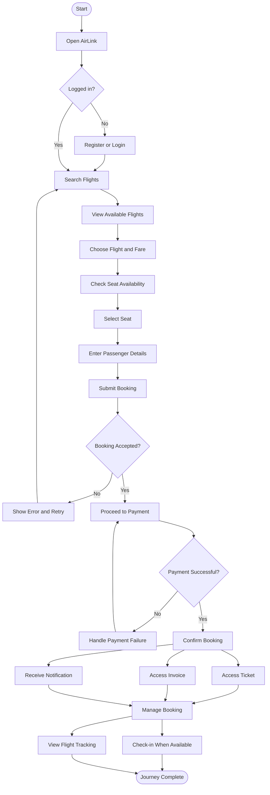
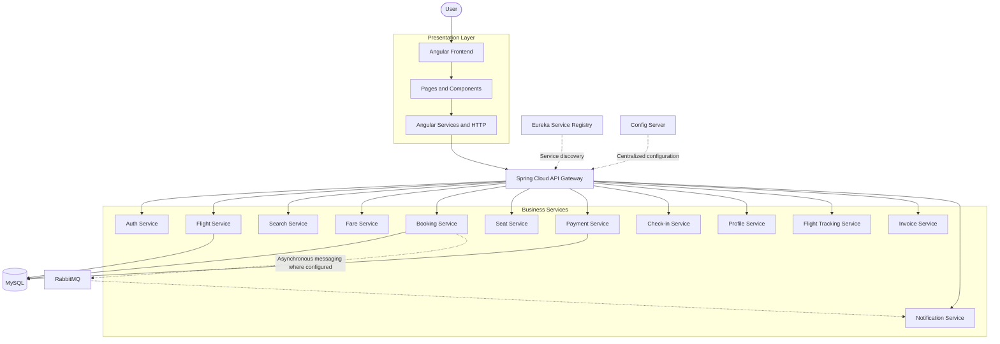

# ✈️ AirLink — Flight Booking System

A full-stack flight booking platform built with **Angular, Spring Boot, and a microservices architecture**. AirLink brings together flight search, fare discovery, seat selection, booking, payments, ticket management, and flight tracking in one connected application.

The goal is simple: make the flight booking journey smooth for users while keeping the underlying system modular, maintainable, and ready to evolve.

<p align="center">
  <a href="https://github.com/moulimds/flight-booking-system">
    <strong>Explore the Repository</strong>
  </a>
</p>

---

## ✨ About the Project

AirLink is designed around two major parts:

- **Frontend:** An Angular application that provides the user interface, manages user interactions, and communicates with backend APIs.
- **Backend:** A collection of Spring Boot microservices that separate business responsibilities into focused services.

Infrastructure components such as an API Gateway, Eureka Service Registry, Config Server, and RabbitMQ support request routing, service discovery, centralized configuration, and asynchronous communication where configured.

Keeping these responsibilities separate makes it easier to develop, test, maintain, and extend individual parts of the system.

## 🧭 Application Flow Map

The flow map below illustrates the user's journey through the application, from opening the website to managing a completed booking.



*This map represents the intended user journey. The exact sequence of booking confirmation, payment handling, ticket generation, and notifications depends on the implemented business logic.*

## 🏗️ System Architecture

AirLink follows a microservices-based architecture. The Angular frontend communicates with backend services through the API Gateway, while infrastructure components help coordinate configuration, discovery, and messaging.



The diagram is a high-level representation. Actual database ownership, service routes, messaging relationships, and dependencies should follow the configuration in each service.

## 💻 Technology Stack

| Layer | Technologies |
|---|---|
| Frontend | Angular, TypeScript, HTML5, CSS3 |
| Frontend tooling | Node.js, npm |
| Backend | Java, Spring Boot |
| Microservices infrastructure | Spring Cloud |
| API routing | Spring Cloud Gateway |
| Service discovery | Netflix Eureka |
| Centralized configuration | Spring Cloud Config |
| Database | MySQL |
| Messaging | RabbitMQ |
| Build automation | Maven |
| Containerization | Docker, Docker Compose |
| Version control | Git, GitHub |
| API testing | Postman or a compatible REST client |

## 🧩 Backend Microservices

Each service focuses on a particular responsibility instead of placing the entire application's business logic inside one large backend.

| Service | Responsibility |
|---|---|
| `api-gateway` | Routes incoming client requests to configured backend services |
| `auth-service` | Authentication and access-related operations |
| `flight-service` | Flight information and related operations |
| `search-service` | Flight search functionality |
| `fare-service` | Fare and pricing-related operations |
| `booking-service` | Booking workflows and booking-related operations |
| `seat-service` | Seat availability and seat-related operations |
| `payment-service` | Payment-related operations |
| `checkin-service` | Passenger check-in functionality |
| `profile-service` | User profile management |
| `flight-tracking-service` | Flight tracking information |
| `invoice-service` | Invoice-related functionality |
| `notification-service` | Notification-related operations |
| `eureka-server` | Service registration and discovery |
| `config-server` | Centralized application configuration |

The services can be developed and tested independently, subject to their API contracts, shared infrastructure, and runtime dependencies.

## 🎨 Frontend Experience

The Angular frontend organizes the user experience into focused feature areas, with shared code reused wherever appropriate.

### Main Feature Areas

- **Authentication:** Login and registration.
- **Flight Search:** Search interfaces and flight results.
- **Booking:** Passenger details and booking workflows.
- **Seat Selection:** Seat selection and availability filters.
- **Payment:** Payment-related user interface.
- **Profile:** User profile interfaces.
- **Ticket and Invoice:** Access to booking documents.
- **Flight Tracking:** Tracking-related interfaces.
- **Check-in:** Check-in-related functionality.
- **Support:** Support interface.

### Angular Structure

The frontend uses feature-specific components and shared resources to keep the application organized.

- **Components:** Build pages and reusable interface elements.
- **Services:** Encapsulate reusable logic and HTTP communication.
- **Models:** Represent application data.
- **Directives:** Provide reusable DOM behavior.
- **Pipes:** Transform values for presentation.
- **Environment configuration:** Holds environment-specific application settings.

## 🔄 How the Services Work Together

### Request–Response Communication

When a user performs an action, an Angular component calls the relevant service. That service sends an HTTP request to a configured backend endpoint. The API Gateway routes the request, the target microservice processes it, and the response is returned to the frontend.

### Service Discovery

Eureka provides a registry through which configured services can register and discover other services.

### Centralized Configuration

The Config Server provides a common configuration source. Services may still require local bootstrap settings or service-specific configuration to initialize and connect successfully.

### Asynchronous Messaging

RabbitMQ provides messaging infrastructure for asynchronous operations where the corresponding queues, exchanges, producers, and consumers are implemented.

## 🗄️ Database and Infrastructure

### MySQL

MySQL is the relational database technology used by the backend. Database names, schema setup, credentials, and connection URLs must match the configuration of the relevant services.

### RabbitMQ

RabbitMQ supports message-based communication where configured. Common default ports are:

- AMQP: `5672`
- Management interface: `15672`

### Infrastructure Ports

The following are the development ports previously used for this project. Verify the active configuration before running the application.

| Component | Port |
|---|---:|
| API Gateway | `8080` |
| Config Server | `8888` |
| Eureka Dashboard | `8761` |
| Angular development server | `4200` |
| RabbitMQ AMQP | `5672` |
| RabbitMQ Management | `15672` |

MySQL's port depends on the local or Docker configuration. For example, a host mapping of `3307:3306` exposes container port `3306` on host port `3307`.

## 🐳 Docker and Docker Compose

Docker helps package services into containers and run the application's infrastructure in a repeatable development environment.

If the root Compose file defines the required services and build instructions, you can inspect the configuration and start the application using:

```bash
docker compose config
docker compose up -d --build
docker compose ps
```

To follow application logs:

```bash
docker compose logs -f
```

To inspect a particular service:

```bash
docker compose logs -f api-gateway
```

To stop the Compose environment:

```bash
docker compose down
```

These commands depend on the service names and definitions in the Compose file. Check the current configuration before running them.

## 🚀 Getting Started

### Prerequisites

Install the following tools before setting up the application:

- Git
- Java JDK compatible with the backend
- Maven
- Node.js and npm compatible with the Angular project
- Docker Desktop and Docker Compose, if running containers
- MySQL and RabbitMQ, locally or through containers
- An IDE such as VS Code or Eclipse

Check the installed versions:

```bash
git --version
java -version
mvn -version
node -v
npm -v
docker --version
docker compose version
```

### 1. Clone the Repository

```bash
git clone https://github.com/moulimds/flight-booking-system.git
cd flight-booking-system
```

### 2. Install Frontend Dependencies

The Angular configuration and npm package files are located at the repository root.

```bash
npm install
```

### 3. Run the Angular Frontend

```bash
npx ng serve
```

Open the local address displayed in the terminal. The default Angular development address is usually:

`http://localhost:4200`

### 4. Configure the Backend

Before launching the backend services, verify that:

- MySQL is running and the required databases exist.
- Database connection properties are correct.
- RabbitMQ is available if a service depends on it.
- Eureka is reachable by the services that register with it.
- The Config Server can access the configured property sources.
- Gateway routes match the target service names and paths.
- Frontend API URLs point to the correct backend endpoint.

Keep credentials and secrets out of version control.

### 5. Build the Backend

Build a service from its directory, where its `pom.xml` is located:

```bash
mvn clean package
```

If the root `pom.xml` defines all backend services as Maven modules, you can instead build from the root:

```bash
mvn clean package
```

Use the build configuration that matches the repository's actual Maven structure.

### 6. Start the Services

A typical startup sequence is:

1. MySQL and RabbitMQ.
2. Eureka Server.
3. Config Server.
4. Backend business services.
5. API Gateway.
6. Angular frontend.

The exact order depends on the configured health checks, service dependencies, retry behavior, and Compose setup.

## 🧪 API Testing

Postman or another REST client can be used to test the backend endpoints.

When testing through the API Gateway, use the gateway's base URL and the route prefixes configured in the application. A commonly used local base URL is:

`http://localhost:8080`

Recommended testing areas include authentication, flight search, fares, seat availability, bookings, payments, check-in, profiles, invoices, tickets, notifications, and flight tracking.

Refer to each service's controllers, DTOs, validation rules, and gateway configuration for the actual HTTP methods, endpoint paths, request payloads, and authorization requirements.

## 📁 Repository Structure

The repository combines the Angular frontend with the Spring Boot backend service modules.

```text
flight-booking-system/
├── api-gateway/
├── auth-service/
├── booking-service/
├── checkin-service/
├── config-server/
├── eureka-server/
├── fare-service/
├── flight-service/
├── flight-tracking-service/
├── invoice-service/
├── notification-service/
├── payment-service/
├── profile-service/
├── search-service/
├── seat-service/
├── src/
│   └── app/
│       ├── core/
│       ├── features/
│       ├── shared/
│       └── ...
├── angular.json
├── package.json
├── package-lock.json
├── pom.xml
├── tsconfig.app.json
├── tsconfig.json
└── README.md
```

The structure above is a simplified overview. The exact contents of individual folders depend on the current repository state.

## 👥 Team Contributions

The following table reflects the previously defined service allocation.

| Team Member | Assigned Areas |
|---|---|
| Mouli | Configuration, Invoice, Payment, CI/CD |
| Sindhu | Booking, Fare, JUnit5, Mockito  |
| Ashad | Seat, Notification, API Gateway, Eureka |
| Gokul | Flight, Search, Profile |
| Abinesh | Authentication, Check-in, Flight Tracking |

Integration, testing, frontend work, and repository maintenance may involve collaboration across the team.

## 🔮 Future Improvements

AirLink can be extended further through:

- Automated unit and integration testing.
- Continuous integration and delivery with GitHub Actions.
- API documentation using OpenAPI/Swagger.
- Centralized logs, monitoring, and distributed tracing.
- Improved error handling and request validation.
- More robust authentication and authorization.
- Secure secrets management.
- Automated Docker builds and deployment.
- End-to-end testing of booking, seat reservation, and payment workflows.
- Accessibility and responsive-design improvements.

## 📌 Project Status

The Angular frontend and backend service modules have been brought together in the repository's `main` branch.

The frontend integration has been committed and pushed to GitHub. Successful builds, complete end-to-end workflows, and production deployment should be verified separately before describing the application as release-ready.

## 🔗 Repository

**GitHub:** [moulimds/flight-booking-system](https://github.com/moulimds/flight-booking-system)

---

*Built collaboratively with a focus on modular architecture, maintainable code, and a smoother flight booking experience.*
